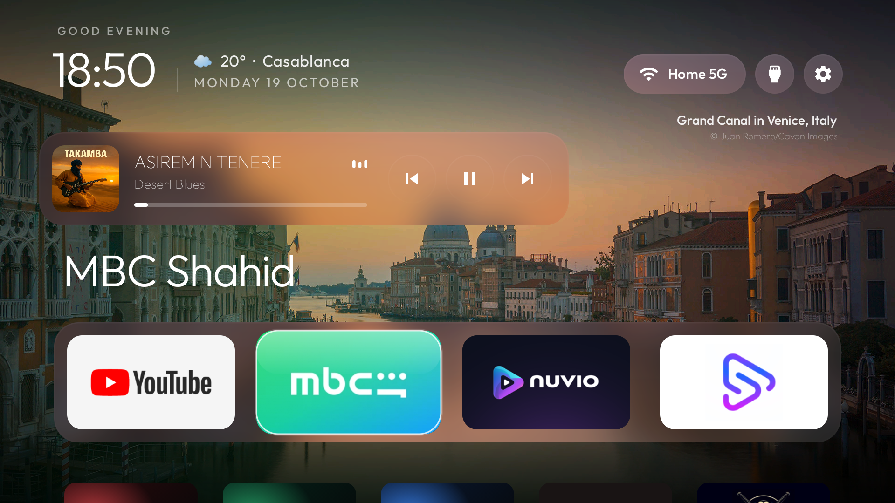
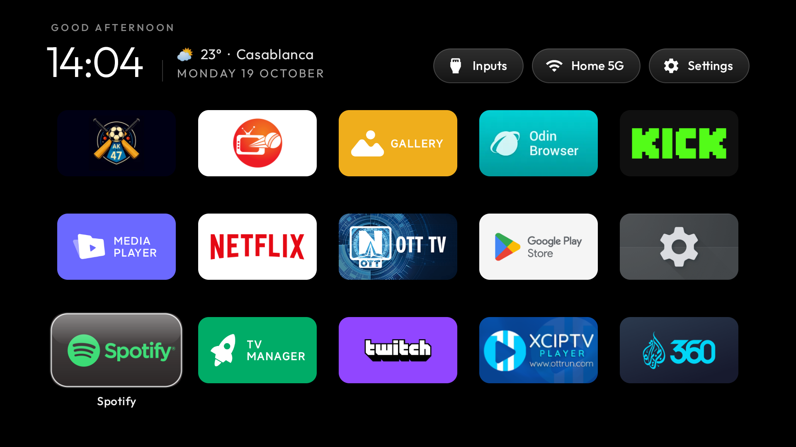
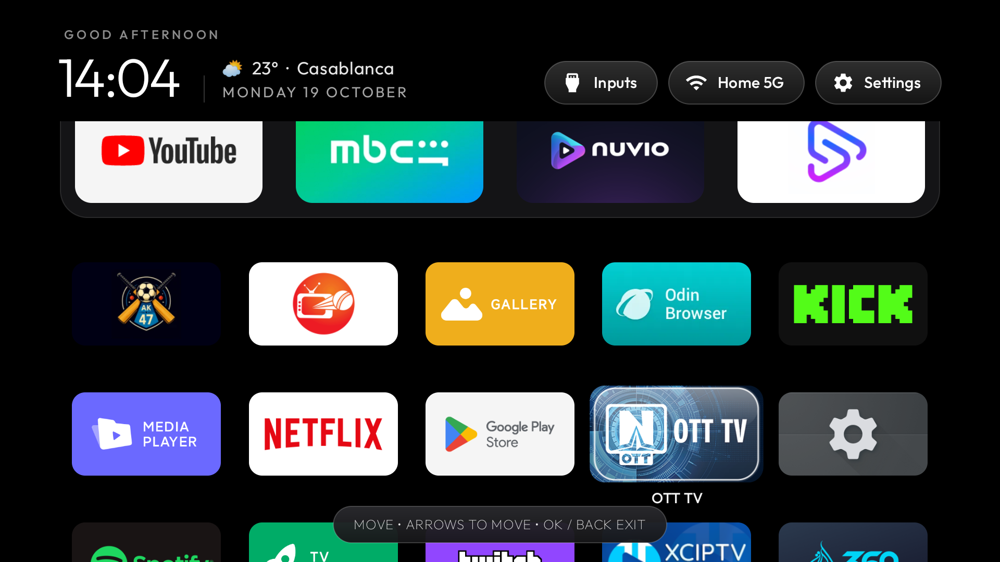
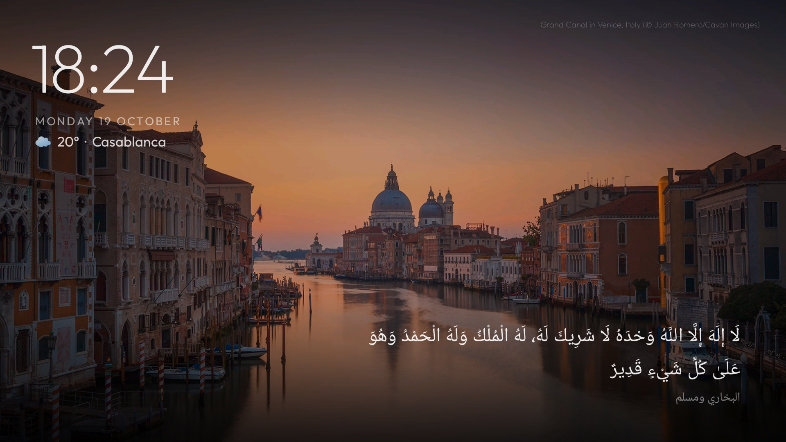

<h1 align="center">CleanXiaomiTV</h1>

<p align="center">My Xiaomi TV, minus the ads: a clean home screen, a richer screensaver and live channels.</p>



<table>
  <tr>
    <td width="50%"></td>
    <td width="50%"></td>
  </tr>
  <tr>
    <td align="center">All apps, five to a row</td>
    <td align="center">Hold OK to move an app with the remote</td>
  </tr>
</table>



**Built and tested on** a Xiaomi MiTV-MOOR2 (venom), Google TV / Android 11, MediaTek, 1080p.

## What it does

- **Debloat**: [`debloat.txt`](debloat.txt) disables 23 packages: Xiaomi and Google telemetry, PatchWall and the ad rows, demo mode, duplicate cast services and preloaded apps. Nothing is uninstalled, and one command restores everything.
- **Ad-blocking DNS**: the installer points the TV's Private DNS at [AdGuard](https://adguard-dns.io), so ads and trackers are blocked in every app.
- **Home screen**: an Apple TV style launcher with a dock of four apps, five smaller tiles per row below it, the weather next to the clock, and the song playing (album art and moving bars) under the top buttons. Hold OK on a tile to move it. English and Arabic.
- **Screensaver**: photos of the day with a slow zoom, the time and weather top left, the song playing bottom left, and a thikr with its source bottom right, a new one every minute.
- **Apps** in [`modules/`](modules/): **Weather** (7-day forecast, city search), **Prayer Times** (Morocco method, countdown to the next prayer) and **Channels** (35 live Moroccan and Arab channels from free streams the broadcasters publish). They show up on the home screen as cards.

## Install

On the TV: Settings → Device Preferences → About → press OK on **Build** seven times, then Developer options → **USB debugging** on.

On a computer on the same Wi-Fi, with JDK 17 and the Android SDK (`brew install openjdk@17 android-commandlinetools`, then `sdkmanager "platforms;android-34" "build-tools;34.0.0"`):

```bash
python3 -m venv tools/venv && tools/venv/bin/pip install -r tools/requirements.txt
export TV_HOST=192.168.1.50                     # your TV's IP; accept "Allow USB debugging?" on the TV

tools/disable.sh debloat.txt                     # debloat
INPUT_KEY_SERVICE=1 launcher/build-and-install.sh   # the launcher, made the default home

cd modules && ./gradlew assembleRelease && cd ..   # the apps
for m in weather prayer channels; do
  tools/venv/bin/python -I tools/b64push.py modules/$m/build/outputs/apk/release/$m-release.apk /data/local/tmp/$m.apk
  tools/venv/bin/python -I tools/tv.py "pm install -r /data/local/tmp/$m.apk; rm -f /data/local/tmp/$m.apk"
done

# the screensaver
tools/venv/bin/python -I tools/tv.py 'settings put secure screensaver_components com.majnioui.cleanxiaomitv/com.gathin.tvhome.ClockDream; settings put secure screensaver_enabled 1'
```

`INPUT_KEY_SERVICE=1` keeps the remote's Input button working once the stock home is gone; Android switches it off on every reinstall, so pass it each time. `PRIVATE_DNS=off` skips the AdGuard DNS.

## Configure

Everything is in [`launcher/app/src/main/res/values/config.xml`](launcher/app/src/main/res/values/config.xml): the dock apps, hidden apps, the weather city (Casablanca by default), `grid_columns`, and switches for each feature (`dream_photos`, `dream_athkar`, `now_playing`). Rebuild with `launcher/build-and-install.sh`, or push a theme from [`themes/`](themes/) without rebuilding.

## Undo

```bash
TV_HOST=192.168.1.50 tools/restore.sh debloat.txt com.google.android.apps.tv.launcherx
```

This re-enables every package in the list, gives Home back to the stock Google TV launcher and switches the AdGuard DNS off. Remove the launcher afterwards in Settings → Apps if you like.

## Network

No analytics and no accounts. The only requests the TV makes for these features go to:
[Open-Meteo](https://open-meteo.com) for the weather (only the city's coordinates), Bing's photo of the day
archive for the screensaver, [Aladhan](https://aladhan.com) for prayer times, [iptv-org](https://github.com/iptv-org/iptv)'s
public lists and the broadcasters' own streams for Channels, and AdGuard as the DNS resolver. Each can be
switched off in `config.xml` (or by not installing that app).

## Credits

Built on [CleanYourTV](https://github.com/Gathin23/cleanyourtv) by [Gathin](https://github.com/Gathin23). MIT licensed, see [`LICENSE`](LICENSE). Font: Outfit (OFL). Icons: Material (Apache 2.0), Feather (MIT), Lucide (ISC).
